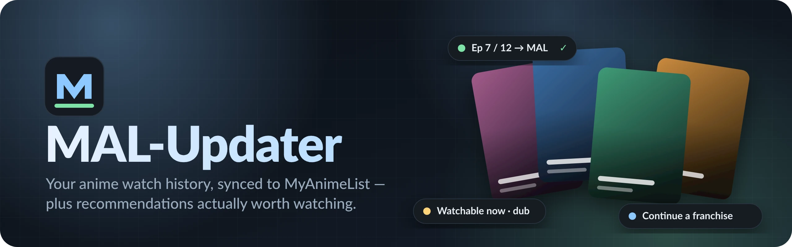
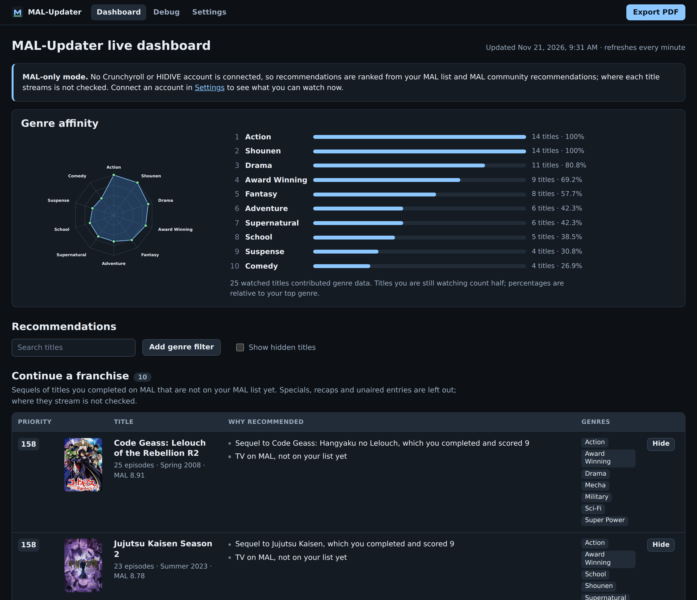
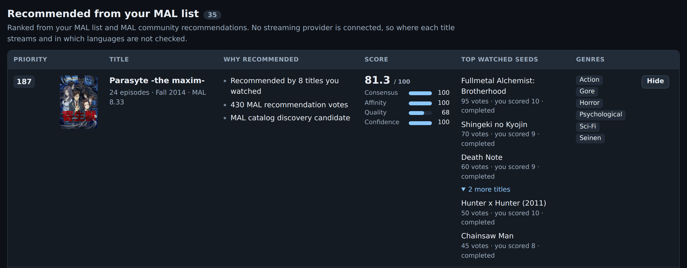
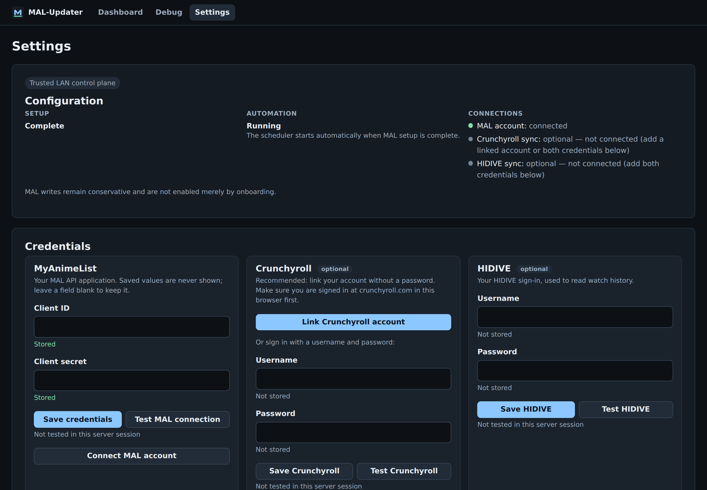
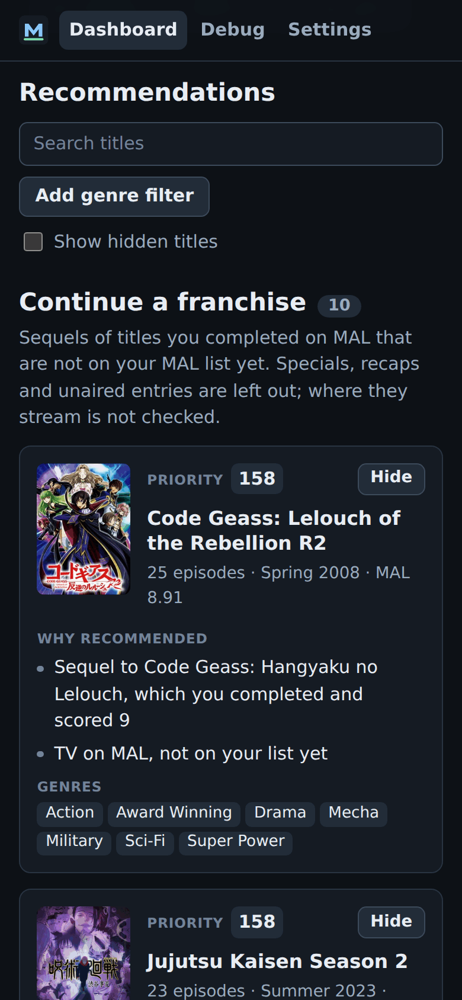
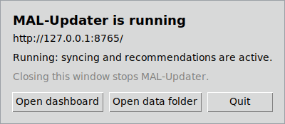
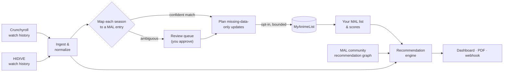

<p align="center">
  
</p>

<p align="center">
  <a href="https://github.com/kklouzal/MAL-Updater/releases/latest"></a>
  <a href="https://github.com/kklouzal/MAL-Updater/actions/workflows/quality.yml"></a>
  <a href="https://github.com/kklouzal/MAL-Updater/actions/workflows/desktop.yml"></a>
  
  
  <a href="LICENSE"></a>
</p>

<p align="center">
  <b><a href="#-download">Download</a></b> ·
  <b><a href="#-features">Features</a></b> ·
  <b><a href="#-screenshots">Screenshots</a></b> ·
  <b><a href="#-quick-start">Quick start</a></b> ·
  <b><a href="#-how-it-works">How it works</a></b> ·
  <b><a href="#-documentation">Docs</a></b>
</p>

---

**MAL-Updater** keeps your [MyAnimeList](https://myanimelist.net) list in step with what you actually watch. It reads your **Crunchyroll** and **HIDIVE** watch history, works out which MAL entry each season belongs to, and fills in the progress you forgot to log, without ever overwriting what you already set on MAL. Then it looks at everything you've watched and tells you **what to watch next**: new seasons of shows you finished, dubbed episodes that just dropped, the backlog you left half-way, and well-matched discoveries ranked from the MAL community's own recommendations.

No streaming service? No problem. With just a MAL account it still ranks recommendations from your list, finds sequels you haven't started, and charts your taste.

It runs **entirely on your machine** as a desktop app or a container. Your passwords, tokens and history never leave it.

<p align="center">
  
</p>

## ⬇ Download

Download, open, done. The desktop app needs **no Docker and no Python**, and opens the dashboard in your browser. Close its window and everything stops; nothing is left running in the background.

<table>
  <tr>
    <th align="center">🪟 Windows</th>
    <th align="center">🍎 macOS · Apple silicon</th>
    <th align="center">🍏 macOS · Intel</th>
    <th align="center">🐧 Linux</th>
  </tr>
  <tr>
    <td align="center"><a href="https://github.com/kklouzal/MAL-Updater/releases/latest/download/MAL-Updater-windows-x64.zip"><b>MAL-Updater-windows-x64.zip</b></a><br><sub>Windows 10/11 · x64</sub></td>
    <td align="center"><a href="https://github.com/kklouzal/MAL-Updater/releases/latest/download/MAL-Updater-macos-arm64.dmg"><b>MAL-Updater-macos-arm64.dmg</b></a><br><sub>M1 and later</sub></td>
    <td align="center"><a href="https://github.com/kklouzal/MAL-Updater/releases/latest/download/MAL-Updater-macos-x64.dmg"><b>MAL-Updater-macos-x64.dmg</b></a><br><sub>Intel Macs</sub></td>
    <td align="center"><a href="https://github.com/kklouzal/MAL-Updater/releases/latest/download/MAL-Updater-linux-x64.tar.gz"><b>MAL-Updater-linux-x64.tar.gz</b></a><br><sub>x64 · glibc 2.35+</sub></td>
  </tr>
</table>

Prefer an always-on install on a server or NAS? Use the [container](#-container). Every release also ships a Python wheel, checksums and signed build provenance on the [releases page](https://github.com/kklouzal/MAL-Updater/releases/latest).

> [!NOTE]
> The builds aren't code-signed yet, so Windows SmartScreen and macOS Gatekeeper ask once before the first start. [Here's how to get past that prompt](references/DESKTOP.md#download).

## ✨ Features

<table>
  <tr>
    <td width="50%" valign="top">
      <h3>🔄 Hands-off MAL sync</h3>
      Watch on Crunchyroll or HIDIVE and your MAL list catches up on its own: episode counts, <code>watching</code> → <code>completed</code>, finish dates. Multi-season shows are split into the right MAL entries, including split-cour Part 1 / Part 2.
    </td>
    <td width="50%" valign="top">
      <h3>🛡️ Never clobbers your list</h3>
      Missing-data-first by design: it never lowers progress, never replaces a score, status or date you set, and never guesses when a match is ambiguous. Uncertain seasons wait for your approval, and automatic writes are <b>off until you opt in</b>.
    </td>
  </tr>
  <tr>
    <td valign="top">
      <h3>🎯 Recommendations that explain themselves</h3>
      Ranked from the MAL community's recommendation graph and weighted by your own scores. Every pick shows <i>why</i>: the shows you watched that point to it, and a score breakdown you can expand.
    </td>
    <td valign="top">
      <h3>📺 Watchable now</h3>
      New seasons and fresh episodes of shows you follow, plus recommendations checked against what Crunchyroll and HIDIVE actually stream. Titles list the audio languages the provider reports, and the Audio filter narrows the list to the language you watch in.
    </td>
  </tr>
  <tr>
    <td valign="top">
      <h3>🧬 Continue a franchise</h3>
      Sequels of shows you completed and liked that aren't on your list yet: TV, ONA, movies and OVAs, re-checked as they air. Works with a MAL account alone.
    </td>
    <td valign="top">
      <h3>📊 Your taste, charted</h3>
      A genre affinity chart built from your completed and in-progress titles, a dashboard with cover art and title, genre and audio-language filters, and <b>Export PDF</b> for a printable report with clickable links.
    </td>
  </tr>
  <tr>
    <td valign="top">
      <h3>🖥️ Desktop app or container</h3>
      One-click apps for Windows, macOS and Linux, or a hardened multi-arch Docker image for always-on servers. Same dashboard, same data layout, so you can move between them.
    </td>
    <td valign="top">
      <h3>🔐 Private by default</h3>
      Runs on your machine or LAN with no cloud service. Crunchyroll links with a TV activation code, so no password is stored. Secrets stay out of every page and log, and backups are verified.
    </td>
  </tr>
</table>

## 📸 Screenshots

<p align="center">
  
  <br><sub><b>Every pick explains itself:</b> why it's recommended, a score breakdown, and the titles you watched that point to it</sub>
</p>

<table>
  <tr>
    <td width="66%" valign="top"><p align="center"><sub><b>Settings:</b> connect MAL and link Crunchyroll right in the browser</sub></p></td>
    <td width="34%" valign="top"><p align="center"><sub><b>Works on your phone</b></sub></p></td>
  </tr>
</table>

## 🚀 Quick start

### 🖥️ Desktop app

1. **[Download](#-download)** the app for your system and start it. The dashboard opens at **http://127.0.0.1:8765/**.
2. Create a free [MAL API app](https://myanimelist.net/apiconfig) and set its **App Redirect URL** to:
   ```
   http://127.0.0.1:8765/oauth/mal/callback
   ```
3. In **Settings**, paste the client ID, click **Connect MAL account**, then optionally **Link Crunchyroll account** or add HIDIVE.

<p align="center"></p>

That's it. Syncing and recommendation refreshes run while the app is open, and anything overdue catches up shortly after you start it again. Your data lives in the usual per-user app-data folder ([details](references/DESKTOP.md#where-data-is-kept)).

### 🐳 Container

For an always-on install on a server, NAS or home lab:

```bash
mkdir mal-updater && cd mal-updater
curl -O https://raw.githubusercontent.com/kklouzal/MAL-Updater/master/compose.yaml
curl -O https://raw.githubusercontent.com/kklouzal/MAL-Updater/master/.env.example
cp .env.example .env        # optional: change the port or pin an image tag
docker compose up -d
```

Open **http://localhost/** (or `http://<lan-host>/`). The image is `ghcr.io/kklouzal/mal-updater:0.4.0` for `amd64` and `arm64`, signed with Sigstore and shipped with an SBOM.

<details>
<summary><b>First-run setup in detail</b></summary>
<br>

1. Open **Settings** and add your MAL app credentials. Saving never contacts MAL; use **Test MAL connection** when you want to check them (rate-limited, with errors redacted).
2. Click **Connect MAL account** to start OAuth. Set the MAL app's callback to the exact URL you browse to plus `/oauth/mal/callback`: `http://localhost/oauth/mal/callback` for local access, or your LAN or proxy URL.
3. Optionally connect providers: **Link Crunchyroll account** (shows a TV activation code to approve at crunchyroll.com/activate; no password is stored) or a Crunchyroll username and password, and a HIDIVE username and password.
4. The scheduler starts on its own once the MAL client ID and OAuth tokens are present. It fetches connected providers, refreshes your MAL list and builds recommendations.
5. **MAL writes stay off until you opt in.** Review a dry run first (see [`OPERATIONS.md`](references/OPERATIONS.md)), then set **Per-run execution bounds → sync_apply** to a positive number of writes per run (for example 8) and restart.

MAL OAuth tokens and provider secrets never appear in any page or API response.

</details>

<details>
<summary><b>Local development build</b></summary>
<br>

```bash
docker compose -f compose.yaml -f compose.build.yaml up -d --build   # container from source
python -m pip install -e ".[dev]" && scripts/quality.sh              # full quality gate
```

</details>

## 🧠 How it works



- **A scheduler** runs each job on its own cadence (provider fetches, MAL list refresh, metadata, recommendations, sync, housekeeping) under per-provider request budgets with pacing and backoff, so it stays a polite API citizen.
- **Season mapping** matches provider seasons to MAL entries by air dates and episode counts within the show's franchise. It auto-approves only clear, uncontradicted matches; anything else goes to your review queue.
- **Sync** is missing-data-first: it fills only what's absent on MAL, never lowers progress, and revalidates against live MAL state right before each write.
- **Everything is stored** in one local SQLite database with versioned migrations, verified backups and automatic compaction.

The full set of rules is in [`DECISIONS.md`](references/DECISIONS.md) and [`OPERATIONS.md`](references/OPERATIONS.md).

## 🔒 Security & privacy

- **Local only.** The desktop app listens on `127.0.0.1`. The container is meant for a trusted LAN or a trusted reverse proxy; don't expose it directly to the internet.
- **No sign-in**, by design: anyone who can reach the dashboard can change settings, so network reachability is the access boundary. Changes still require a CSRF token from a same-origin page, and cross-site requests, unknown hosts and oversized bodies are rejected.
- **Secrets** are files readable only by your user, and are redacted from pages, logs and support bundles.
- **Hardened container:** non-root user, read-only root filesystem, `no-new-privileges`, all but a minimal set of capabilities dropped, and a bounded `tmpfs`.

The full threat model is in [`CONTAINERS.md`](references/CONTAINERS.md).

<details>
<summary><b>🧰 Container operations: backup, restore, upgrades, health</b></summary>
<br>

All lifecycle commands use the Compose `tools` profile and the same volume:

```bash
docker compose --profile tools run --rm cli version
docker compose --profile tools run --rm cli backup /data/backups/manual.tar.gz
docker compose --profile tools run --rm cli backup-inspect --verify /data/backups/manual.tar.gz
docker compose --profile tools run --rm cli restore --dry-run /data/backups/manual.tar.gz
docker compose --profile tools run --rm cli restore --yes /data/backups/manual.tar.gz
docker compose --profile tools run --rm cli support-bundle /data/state/support/support.tar.gz
```

- **Backups** contain a SQLite-consistent database copy, config, secrets, state, a manifest and SHA-256 checksums. Keep destinations under `/data`. Restore verifies first, requires `--yes`, and takes an automatic pre-restore backup. Support bundles are redacted: no secrets, usernames, database rows, tokens or logs.
- **Upgrades:** back up, pin the new tag in `.env`, then `docker compose pull && docker compose up -d`. Migrations run before readiness turns green. To roll back, restore the pre-upgrade backup and pin the previous tag; never run an older image against a newer database. After upgrading across the per-season sync migrations (032+), run a full provider refresh ([`OPERATIONS.md`](references/OPERATIONS.md)).
- **Health:** `/healthz` returns 200 whenever the web process answers. `/readyz` returns 200 only while MAL setup is complete and the scheduler is running, and 503 with the blocking reason otherwise.
- **CLI:** the full command set ([`cli-recipes.md`](references/cli-recipes.md)) runs inside the container, for example `docker compose exec -u 10001:10001 mal-updater mal-updater health-check --format summary`.
- **Native install:** a source checkout can also run as a user-level systemd service ([`AUTOMATION.md`](references/AUTOMATION.md)). Never point it at the container's data volume.

</details>

<details>
<summary><b>🩺 Troubleshooting</b></summary>
<br>

| Symptom | Fix |
| --- | --- |
| Dashboard or Settings won't load | Check `docker compose logs --tail=200 mal-updater`, and use a hostname that is loopback, a private IP, or listed in `MAL_UPDATER_TRUSTED_HOSTS`. |
| Readiness is degraded | Finish MAL credentials and OAuth, or check the logs if the scheduler keeps restarting. |
| MAL says the redirect URL doesn't match | Set the MAL app callback to exactly the URL in your browser plus `/oauth/mal/callback`. On the desktop app, browse to `127.0.0.1`, not `localhost`. |
| A change fails with a CSRF error after a restart | Reload the page to get a fresh token. |
| Nothing is written to MAL | Check that `sync_apply` is opted in, that no seasons are waiting in `season-mappings --unresolved`, and what `health-check` warns about. |
| The desktop app won't start: port 8765 in use | Another program has the port. Start it with `--port N` and update the MAL redirect URL to match. |

</details>

<details>
<summary><b>❓ FAQ</b></summary>
<br>

**Will it mess up my MAL list?**<br>
It's built not to. It only fills in data that's missing, never lowers progress, never replaces a score, status or date you set, and does nothing at all on MAL until you turn on `sync_apply`. Ambiguous matches wait for your approval.

**Do I need Crunchyroll or HIDIVE?**<br>
No. With only a MAL account you get recommendations, Continue a franchise, the genre chart and PDF export. A provider adds watch-history sync and the *Watchable now* check.

**Sub or dub? Which languages?**<br>
Any. Recommendations don't prefer a language: each title shows the audio languages Crunchyroll or HIDIVE report, and new episodes follow the version you're watching. To see only titles you can watch in a particular dub, pick it in the dashboard's **Audio** filter; your browser remembers the choice.

**Does it store my Crunchyroll password?**<br>
Not if you use **Link Crunchyroll account**, which uses a TV activation code. Username and password login is available as an alternative and is stored only in your local secrets folder.

**Does anything run when the desktop app is closed?**<br>
No. Closing the window stops the web server, the scheduler and any running task. For around-the-clock syncing, use the container.

**Can I move from the desktop app to Docker, or back?**<br>
Yes. Both use the same data layout, so copy the data folder into the container's `/data` volume, or the other way round.

**Is this affiliated with MyAnimeList, Crunchyroll or HIDIVE?**<br>
No. It's an independent open-source project that uses your own accounts.

</details>

## 📚 Documentation

| | |
| --- | --- |
| 🖥️ [**Desktop app**](references/DESKTOP.md) | Downloads, first start, data folder, options, building it yourself |
| 🐳 [**Containers**](references/CONTAINERS.md) | Architecture, threat model, settings API |
| ⚙️ [**Operations**](references/OPERATIONS.md) | Scheduler jobs and defaults, housekeeping, sync and season behavior |
| ⌨️ [**CLI cookbook**](references/cli-recipes.md) | Every command, with examples |
| 🔑 [**MAL OAuth**](references/MAL_OAUTH.md) | Native OAuth setup |
| 🧾 [**JSON contracts**](references/JSON_CONTRACT.md) | Snapshots, telemetry and command output formats |
| 🧭 [**Design decisions**](references/DECISIONS.md) | Why things work the way they do |
| 🏗️ [**Architecture**](ARCHITECTURE.md) | Repository layout |
| ✅ [**Quality gates**](references/QUALITY.md) | Lint, types, tests, coverage, distribution checks |
| 🛠️ Configuration | [`settings.toml.example`](references/settings.toml.example) · [`env.example`](references/env.example) |

## 🤝 Contributing

Bug reports and ideas are welcome on the [issue tracker](https://github.com/kklouzal/MAL-Updater/issues). For code changes, run the same gate CI runs before opening a pull request:

```bash
python -m pip install -c constraints/ci.txt -e ".[dev]"
scripts/quality.sh
```

## 📦 Releases & support

MAL-Updater is **alpha** software that follows semantic versioning. Each version tag builds the desktop apps, multi-arch GHCR images, wheels and sdists, checksums, build provenance and SBOM, a keyless Sigstore signature, and a curated Compose bundle. Back up before every upgrade. Release history is in [`CHANGELOG.md`](CHANGELOG.md).

## 📄 License

[MIT](LICENSE) © Kyle Klouzal

<sub>MyAnimeList, Crunchyroll and HIDIVE are trademarks of their respective owners. MAL-Updater is not affiliated with or endorsed by them.</sub>
